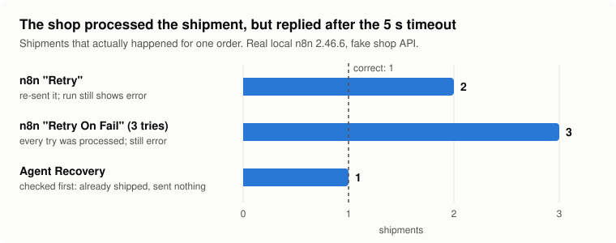

# Agent Recovery

**When an automation fails halfway, retrying it can do the same work twice.**
Agent Recovery finds those duplicates before they happen, notices failures as they happen, and re-runs only the work that was really left undone, after a human approves it.

The first target is [n8n](https://n8n.io). The same idea is also tested on an AI assistant that pays for things on the user's behalf.

## What I found (self-hosted n8n, November 2026)

Most tests used a local fake shop / mail API so I could count exactly what happened on the other side; one used a real Google Sheet.

| Situation | n8n built-in behavior | With Agent Recovery |
|---|---|---|
| API returns 503 once, nothing processed | Retry resumes from the failed node, **no duplicates** ✅ | (not needed) |
| 50 emails, request #33 fails with 503 | Retry re-runs the whole node: **99 sent, 49 people get it twice** | 50 sent, **0 duplicates** (only the 1 missing email re-sent) |
| Same, with node "Retry On Fail" (3 tries) | 99 sent, 49 duplicates, and the run is marked **success** | Flagged as high risk by `check.py` before it runs |
| Shipping request processed, but reply arrives after the 5 s timeout | Retry ships again (**2 shipments**). Retry On Fail: **3 shipments**, still marked error | Sees it was already shipped, **sends nothing** |
| AI assistant pays, reply is late (no n8n) | A typical retry loop **charged 3 times and told the user "payment failed"** | Checks first, **charged once**, reports "payment confirmed" |
| One item gets 503 (not written), another is written but times out, and the lookup lags 8 s behind writes | v0.1 trusted the early "not found" and re-sent both: **1 duplicate** | v0.3 re-sends nothing automatically: the written item is found later, the 503 item goes to a human. **0 duplicates**, 1 email left for a human |
| **Real Google Sheets** (via an Apps Script web app): 5 orders written, one reply delayed past the 5 s timeout | All 5 rows were in the sheet, but n8n marked the run failed; Retry wrote all 5 again: **5 duplicate rows**, still failed | Looked up each order in the sheet, found all 5, **sent nothing** |
| Service has no "was this processed?" lookup | Retry: 49 duplicates | Recovery alone can't finish safely (1 email missing, handed to a human). **Adding an Idempotency-Key before the run** makes plain n8n Retry safe: 50 sent, 0 duplicates |

### The timeout case in one picture



The shop API processes the shipment immediately but replies after 10 s; the workflow waits 5 s. n8n records a failure each time, so both of its retry options ship again. Agent Recovery asks the shop first, sees the shipment exists, and sends nothing. (Measured on a real local n8n 2.46.6 with v0.1; the current rules make the same decision for this case once the settle window has passed.) Suggested on the [community thread](https://community.n8n.io/t/327579).

Full numbers, execution IDs and notes (in Korean): [`experiments/results_ko.md`](experiments/results_ko.md)

## How it works

| Tool | When | What it does |
|---|---|---|
| `check.py` | Before failures | Reads every workflow and flags side-effect nodes (send, pay, ship…) that have auto-retry on, process many items at once, use short timeouts, or have no Idempotency-Key |
| `watch.py` | As failures happen | Polls n8n every 10 s for new failed executions, builds a recovery plan, sends a macOS notification, and serves an approval page at `127.0.0.1:8100` |
| `chaos.py` | Before you ship | Runs your workflow against a local sink that injects a 503 or a late reply, then reports duplicates and missing items |
| `recover.py` | After a failure | For each item of the failed node, asks the target service "already processed?"; re-sends only the missing ones with an Idempotency-Key; asks before sending |

Design rules:
- **Check before re-sending.** A failure in n8n does not mean nothing happened on the other side.
- **Check every item, not a position.** n8n sends items concurrently, so "the 33rd item failed" is not stable (in one real run it was customer 24).
- **Only re-send automatically when it is provably safe.** That means either the service's lookup reflects writes immediately (`"lookup_mode": "strong"`) and says the item is not there (after a settle window if the request timed out), or the first attempt already carried the same Idempotency-Key (`"idempotent_first_attempt": true`). A timeout, a bare 503, a lagging "not found", or a malformed lookup answer (`{}`, `"false"`) is not proof that nothing was written, so those items go to a human. These rules came from [feedback on the n8n community forum](https://community.n8n.io/t/327579).
- **Claim before sending.** Each item is claimed with an atomic file create and marked `sending` before the request, so two recovery workers can't send the same item, and a crash between sending and recording leaves a `sending` record for a human to check.
- **Hand a person the request, not just the ID.** Each recovery send is recorded with its exact method, URL, headers and body before it goes out. For items left to a person, `.ar_state/review/<execution>.json` lists why it wasn't sent, the lookup answer, and the first attempt's request. n8n doesn't store the bytes a failed node sent, so that first request is rebuilt from the execution data and labeled as rebuilt. Raised on the forum by BorkoB.
- **Report only what was observed.** The tool reports how many requests it sent; whether duplicates exist has to be checked in the destination.
- **Never guess.** If the service can't say whether an item was processed, don't send it; hand it to a human.
- **A human approves anything that sends, pays or ships.**
- **n8n is only read.** A read-only n8n API key is enough.

## Try it

Requirements: Python 3 (standard library only), n8n running locally (`npx n8n`), and a read-only n8n API key.

```bash
echo "N8N_API_KEY=your-read-only-key" > .env

python3 experiments/fake_shop.py      # fake shop / mail API on 127.0.0.1:8000
# import experiments/*.json into n8n, then open 127.0.0.1:8000/scenario/3 to pick a scenario

python3 ar.py check                   # find risky settings before anything fails
python3 ar.py watch                   # watch for failures, approve at 127.0.0.1:8100
python3 ar.py list                    # recent failed executions
python3 ar.py recover <execution-id>  # recover one execution by hand
python3 ar.py services                # which services it knows how to check

python3 experiments/agent_checkout_demo.py   # AI assistant payment experiment (no n8n)
python3 experiments/exp6_no_lookup_demo.py   # service without a lookup (simulated n8n behavior)
python3 experiments/exp7_ambiguous_demo.py   # 503 vs committed-but-timed-out, with a lagging lookup
```

### Chaos test before you ship a workflow

Suggested on the forum by someone who had the same incident in production: run an injected-failure test every time a workflow changes.

```bash
python3 ar.py chaos prepare <workflow-id>   # copy of the workflow whose HTTP writes go to a local test sink
python3 ar.py chaos learn <workflow-id>     # optional: learn request shapes from real successful runs
python3 ar.py chaos serve --fail-nth 33     # sink: request #33 gets a 503 (add --late-nth 20 for a late reply, --contract to enforce shapes)
# paste the chaos_<id>.json into n8n and publish it, then one command:
python3 ar.py chaos run http://127.0.0.1:5678/webhook/chaos-<workflow-id>
```

`prepare` adds a `chaos test trigger` webhook to the copy, wired like the original trigger. `run` clears the sink, calls the webhook, waits for the workflow to finish, and prints the verdict. It exits with 0 on pass, 1 on fail and 2 if the test couldn't run, so it can go in CI and run on every workflow change. (`chaos report` and `chaos reset` are there for manual runs.)

On a real local n8n 2.46.6, with a 503 injected at request #33 of a 50-email workflow:

| Workflow | Writes | Verdict | n8n showed |
|---|---|---|---|
| No retry | 50 | **fail**: 1 missing | error |
| Retry On Fail (3 tries) | 100 | **fail**: 49 duplicates | success |
| Retry On Fail + `Idempotency-Key: order-confirm-{{ $json.to }}` | 100 | **pass**: 49 safe retries | success |

`chaos run` reproduced the last two rows from one command each: Retry On Fail without a key exited with **1** (49 duplicates), with the key it exited with **0**. In both runs n8n answered the webhook with 200.

The last row passes only because the sink honors the key, the way a destination that supports idempotency keys would.

**Keeping the sink honest (contract).** A sink that accepts anything can pass a workflow the real API would reject; this was pointed out on the forum by EKH1. `python3 ar.py chaos learn <workflow-id>` reads the workflow's recent successful executions and records, for each write, which fields and types the real API accepted and one real response. `chaos serve --contract contract_<id>.json` then answers with that real response and rejects with 400 (and fails the verdict) any request with a missing field, a new field, or a changed type. This is only "the shapes the real API accepted before", not the API's rules: a harmless new field is flagged, and a rule the API changes is missed until you run `learn` again. So far it is covered by unit tests only, not yet run against a real n8n.

Nothing real is sent during the test: every write goes to the sink. Requests that carry the same `Idempotency-Key` twice count as safe retries. Without a key, two identical writes count as a duplicate, which can be a false alarm if your workflow is meant to send the same thing twice.

### Tests

```bash
python3 -m unittest discover -s tests -v
```

Regression tests for the cases raised on the forum: malformed lookups, a lookup that lags longer than the settle window, a timed-out write, two workers racing for the same item, and a crash between sending and recording. One test intentionally shows the assumption failing: if a lagging service is misconfigured as `strong`, a duplicate happens.

### Adding a service

`services.json` says, for each URL your workflows send to, how to ask "was this item already processed?":

```json
{
  "name": "My mail API",
  "match": "https://api.example.com/send",
  "id_field": "to",
  "lookup": "https://api.example.com/messages?to={id}",
  "headers": {"Authorization": "Bearer ${MAIL_API_TOKEN}"},
  "exists": "data.found",
  "lookup_mode": "eventual",
  "settle_seconds": 30
}
```

Add `"idempotent_first_attempt": true` only if your workflow already sends the same Idempotency-Key on the first attempt. `{id}` becomes the item's value of `id_field`, `${NAME}` is read from `.env` (keep secrets out of this file), and `exists` is the path to a true/false value in the lookup's JSON. A service without a `lookup` is never re-sent automatically; its items go to a human.

`benchmark/` is an earlier simulation comparing three recovery strategies on 24 synthetic failure cases. I wrote the cases and the strategies myself, so its 24/24 score only shows the comparison set-up works; it is not evidence of real-world accuracy.

## Limitations (v0.1)

- Only HTTP Request nodes are recovered.
- Recovery needs the target service to answer "was this processed?". So far that is the fake shop's `/check` and one real Google Sheet behind a small Apps Script web app I wrote (`experiments/sheets_apps_script.gs`). n8n's own Google Sheets / Gmail nodes and services like Stripe are not connected yet. In the Sheets test the late reply was caused on purpose by the script.
- Nodes after the failed node are not continued.
- `lookup_mode` and `settle_seconds` are assumptions about each service. If a service is set to `strong` but its lookup actually lags, a duplicate is still possible (there is a test that shows this).
- Claims are files in `.ar_state/` on one machine. Workers on different machines or containers don't share them, so this does not stop two separate hosts from sending the same item; that needs a shared store (for example a database row with a unique constraint).
- An item whose previous recovery stopped at `sending` is never re-sent automatically; it is shown as unknown for a human.
- With a lagging lookup and no idempotency key, the tool is safe but incomplete: items it can't prove are left for a human.
- Per-item error output in n8n is not read yet; the experiment for it simulates n8n's behavior.
- Experiments 4–8 were run outside n8n (simulated); experiments 1–3 and the tools were run on a real local n8n.

## My decisions

**Why I chose this problem**
Agent automation is already being used in real life, and I was curious how these systems deal with problems when something goes wrong: how they handle it, re-run the work, and get everything back in sync.

**What surprised me**
I found out that recovery after a failure was already much more developed than I had expected. But I also saw the opposite: when a node failed after 49 of 50 emails had gone out, n8n's Retry sent all 50 again, and with Retry On Fail the run was even marked as a success.

**Why recovery needs human approval**
When there is a mistake or an error, letting the tool decide on its own could cause an even bigger problem. That is why it asks for approval before doing anything.

**What it can't do yet**
I think this tool still needs more research and validation.
